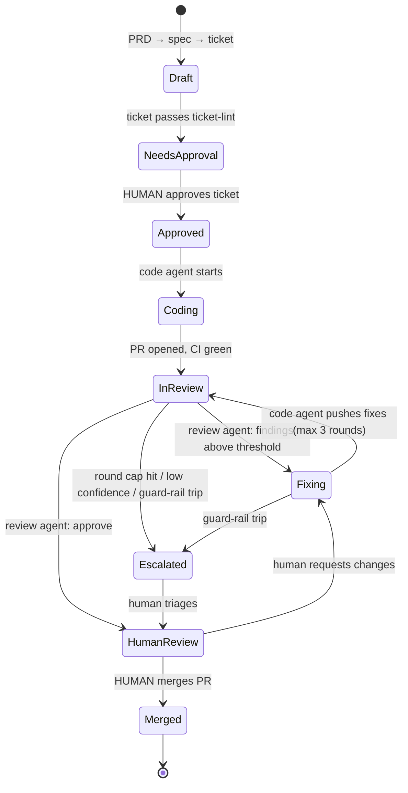

# AgenticAI – Order & Payments Orchestration Platform

A cloud-native, multi-tenant order and payments backend (Go + Java microservices on Kubernetes), **built by an agentic AI harness with humans at the two gates that matter**: approving the ticket and merging the PR.

The product requirements live in the PRD (Order & Payments Orchestration Platform). This repo turns that PRD into specs, specs into tickets (GitHub issues), and tickets into reviewed pull requests.

## The harness flow

| Stage | Who | Rule |
|---|---|---|
| Spec → ticket | Human + agent | Every ticket states why, what, constraints, acceptance tests, files in scope (`.github/ISSUE_TEMPLATE/ticket.yml`) |
| **Ticket approval** | **Human** | Label `status:approved` is applied by a human only |
| Code | Code agent | Bound by [`agents/guardrails.md`](agents/guardrails.md) and [`agents/code-agent.md`](agents/code-agent.md) |
| Review | Review agent | Independent context; findings carry confidence; see [`agents/review-agent.md`](agents/review-agent.md) |
| Fix | Code agent | Verifies each finding, then accepts (fixes) or disputes with evidence; at most 3 review rounds |
| **Merge** | **Human** | Agents have no merge rights; `main` is branch-protected |

The code agent and review agent are **separate actors with separate identities, credentials and sessions** that review each other's work ([`agents/actors.md`](agents/actors.md)). Full flow: [`agents/workflow.md`](agents/workflow.md).

## Repo map

| Path | Purpose |
|---|---|
| `specs/` | One spec per service/area, derived from the PRD, with requirement IDs |
| `tickets/phase-1/` | Ticket drafts (source of truth for the GitHub issues) |
| `agents/` | Code agent, review agent, guard rails, workflow state machine |
| `.github/` | Ticket and PR templates, CI, labels, CODEOWNERS |
| `scripts/` | Label and issue bootstrap |
| `docs/` | Roadmap and decisions |

Service code (`services/`, `libs/`, `deploy/`) is created by tickets, not by hand.

## Status

Phase 1 (foundation and walking skeleton) tickets are open as GitHub issues labelled `phase:1` and `status:needs-approval`. See [`docs/roadmap.md`](docs/roadmap.md).
